<p align="center">
  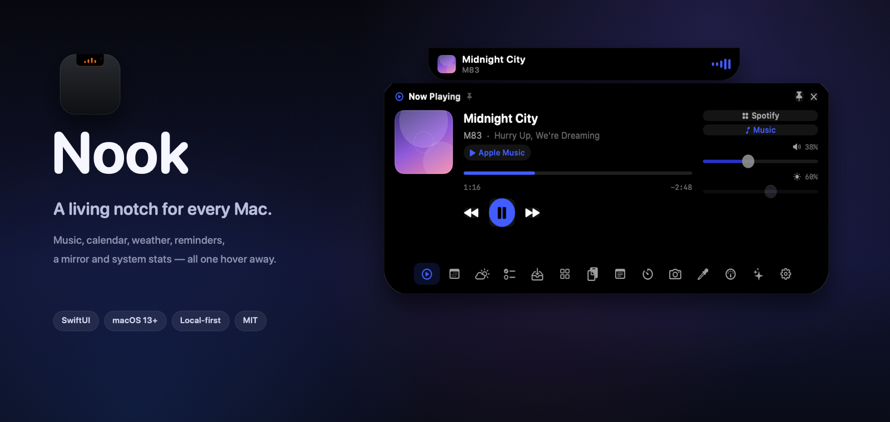
</p>

<h1 align="center">Nook</h1>

<p align="center">
  <b>Music, calendar, weather, reminders and system stats — one hover away from the notch.</b><br>
  A local-first macOS overlay written in SwiftUI. No Dock icon, no account, no telemetry.
</p>

<p align="center">
  
  
  
  
</p>

<p align="center">
  <a href="#install">Install</a> ·
  <a href="#everything-in-one-hover">Screenshots</a> ·
  <a href="docs/BUILDING.md">Building</a> ·
  <a href="docs/ARCHITECTURE.md">Architecture</a> ·
  <a href="docs/PRIVACY.md">Privacy</a>
</p>

---

Nook turns the area around your Mac's camera housing into a small, quiet command
surface. There is no window to arrange and no Dock icon to manage: the notch
itself grows when you need it.

Hover to peek, click to pin, press <kbd>Esc</kbd> to let it go. On Macs without a
notch, the same surface lives in the center of the menu bar.

## The notch that stays useful

<p align="center">
  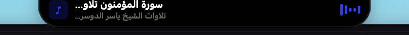
</p>

While audio is playing, a compact strip hugs the top edge of the screen — exactly
like the built-in notch silhouette, square top corners and all. Artwork, title,
artist and an animated wave are readable at a glance without covering your windows.

The strip is also a live surface, not just a label:

| Live activity | What it shows |
| --- | --- |
| **Now playing** | Artwork, title, artist and wave bars; hover to open the full player |
| **Timer / stopwatch** | Remaining time and a progress ring while a countdown runs |
| **Next meeting** | The upcoming event and how many minutes are left |
| **Agent runs** | Which CLI is working and the latest line of output |
| **Charging** | A short battery HUD when you plug in |
| **Bluetooth** | A face-off when headphones or keyboards connect or disconnect |
| **Volume / brightness** | A slim HUD that mirrors the system keys |

## Everything in one hover

<p align="center">
  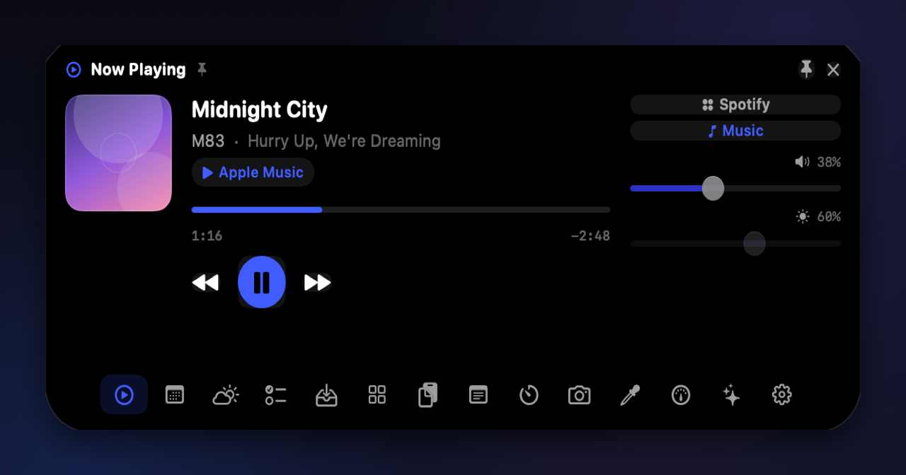
</p>

Fourteen small tools share one calm shell. Panels are lazy: they only ask for
permissions or data when you open them, and every one of them collapses back
into the same notch.

| | | |
| --- | --- | --- |
| **Now Playing** — transport, seek, volume and output device for Music, Spotify and browser media | **Calendar** — the rest of today and the days after, with one-click meeting links | **Weather** — current conditions plus a five-day outlook for any city |
| **Reminders** — your lists, ticked off in place | **Timer** — presets, a live ring and a collapsed countdown | **Mirror** — a quick camera check before a call |
| **Notes** — a scratchpad that survives restarts | **Agents** — chat with Qoder CLI or OpenCode without leaving the notch | **System** — CPU, memory, disk, battery, network, load and uptime |
| **Shelf** — drop files, images and archives to hold them for later | **Shortcuts** — launch apps, folders and URLs | **Clipboard** — text, image and file history with one-click restore |
| **Color** — a screen eyedropper with a magnified picker | **Settings** — gestures, size, accent, tabs and permissions in one place | |

<details>
<summary><b>See every panel</b></summary>

<br>

| Now Playing | Calendar | Weather |
| --- | --- | --- |
|  | 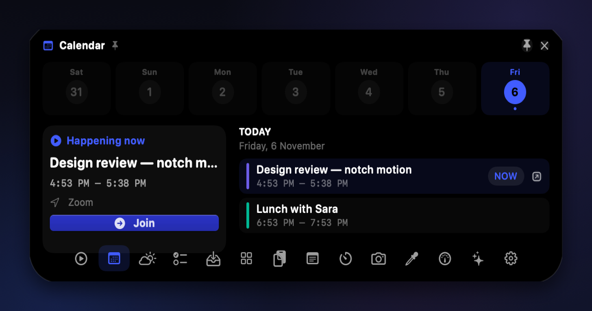 | 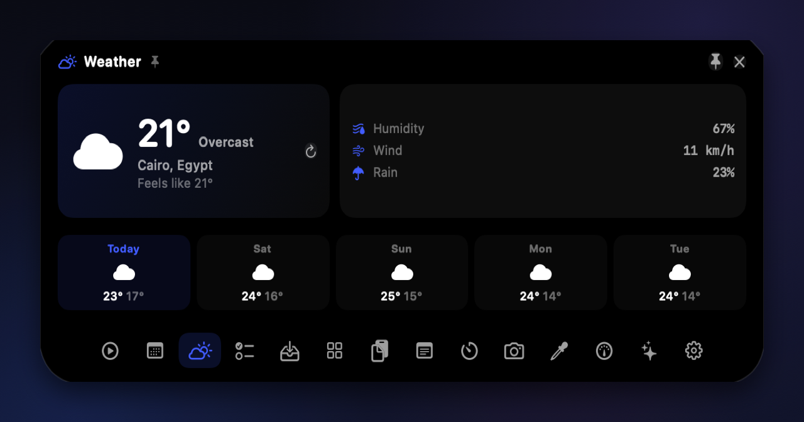 |

| Reminders | Timer | Notes |
| --- | --- | --- |
| 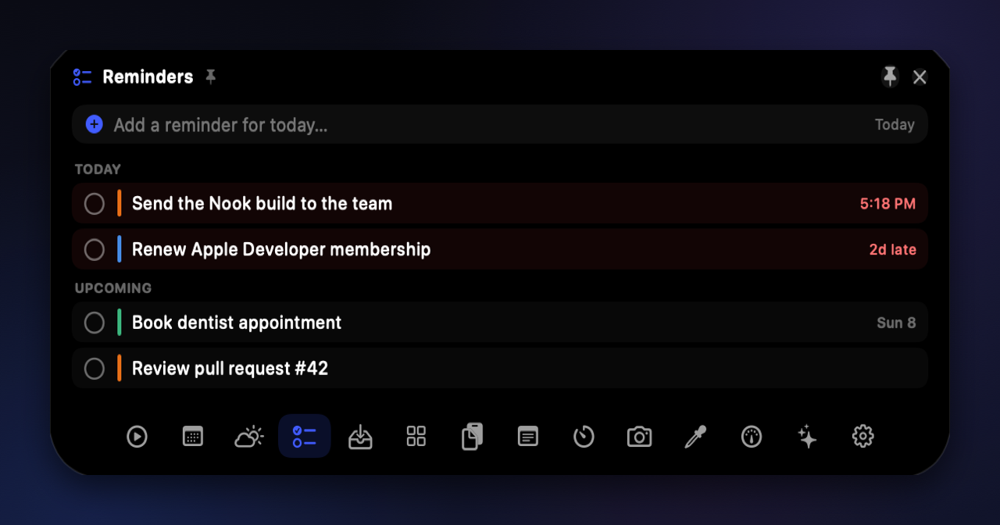 | 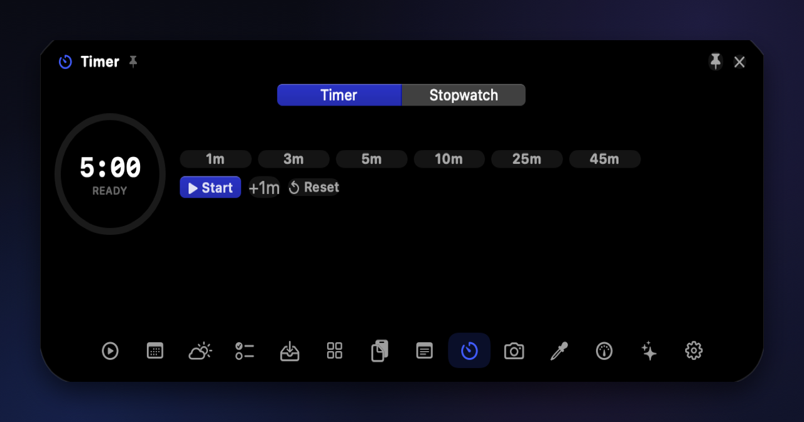 | 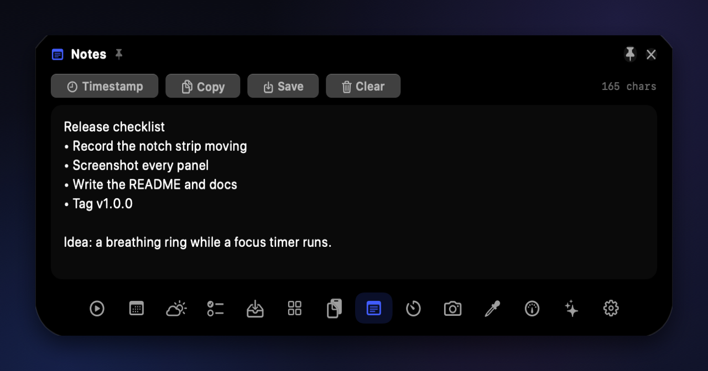 |

| Agents | System | Mirror |
| --- | --- | --- |
| 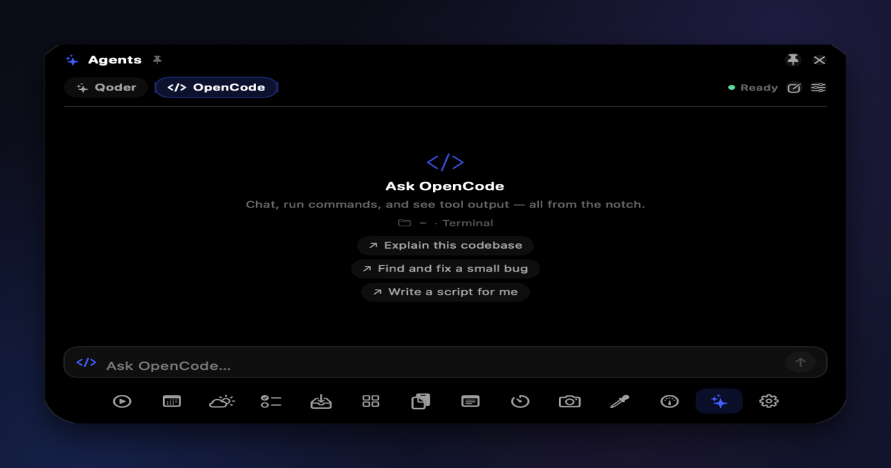 | 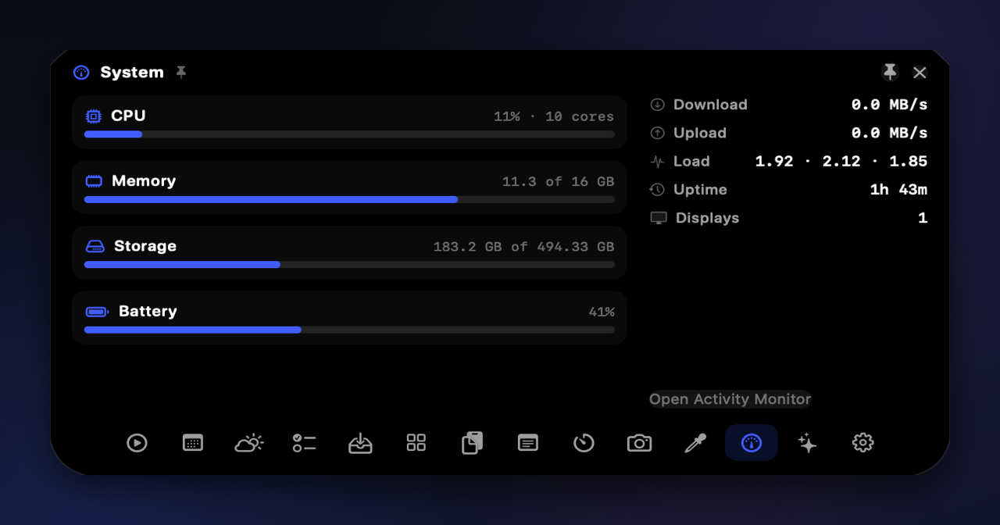 | 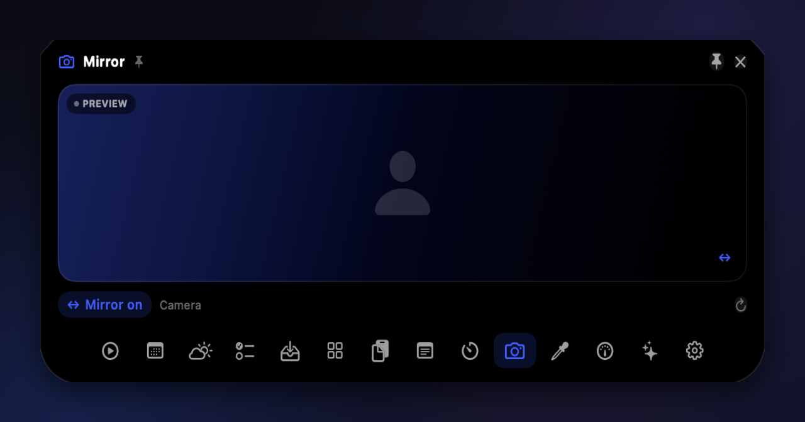 |

| Shelf | Settings |
| --- | --- |
| 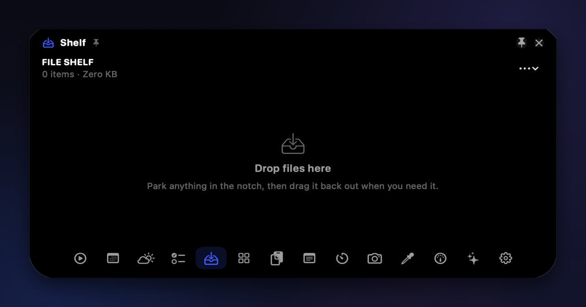 | 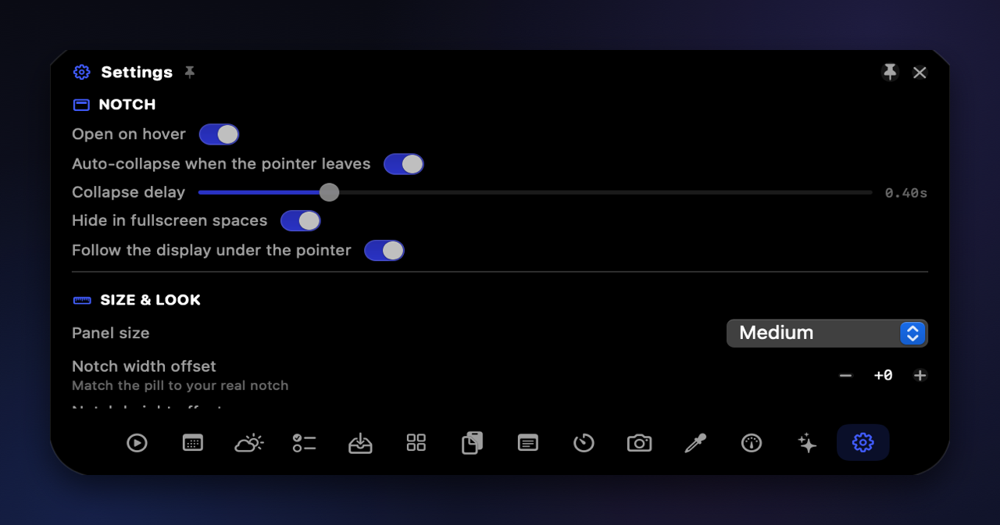 |

</details>

The full gallery, with descriptions, lives in [docs/GALLERY.md](docs/GALLERY.md).

## Install

Nook is a Swift package; building it takes one script. You need macOS 13 or
later, Xcode command line tools, and a Swift 5.10 toolchain.

```bash
git clone https://github.com/ahmedragab112/nook.git
cd nook
./Scripts/build_app.sh
cp -R Nook.app /Applications/
open /Applications/Nook.app
```

`build_app.sh` compiles an Apple Silicon release build, assembles `Nook.app`,
rebuilds the MediaRemote adapter, and ad-hoc signs the bundle. There is no
installer, helper daemon or login item until you enable **Launch at login**.

> On an Intel Mac, change `--arch arm64` to `--arch x86_64` (or remove it) in
> `Scripts/build_app.sh` before building.

## Gestures and shortcuts

| Action | Result |
| --- | --- |
| Hover over the notch | Open the panel under your pointer |
| Click | Pin the panel so it stays while you work |
| Scroll over the notch | Open it pinned |
| Swipe down on the notch | Open it pinned |
| <kbd>Esc</kbd> | Unpin and collapse |
| <kbd>←</kbd> / <kbd>→</kbd> | Move between tabs while the panel is open |
| <kbd>⌃</kbd><kbd>⌥</kbd><kbd>N</kbd> | Show / hide from anywhere (configurable) |
| Click outside | Unpin and collapse |

The hotkey, hover/click/scroll/swipe behaviour, auto-collapse delay, panel size,
notch offsets, accent colour, opacity and visible tabs are all in **Settings**.
Nook also has a **Quit** button there — it is an accessory app, so there is no
Dock icon to right-click.

## Permissions

Everything is optional and asked for only when a panel needs it.

| Permission | Used by | If you decline |
| --- | --- | --- |
| Calendar | Calendar panel and next-meeting activity | The panel stays empty; nothing else changes |
| Reminders | Reminders panel | The panel shows its permission state |
| Camera | Mirror panel | The panel shows its permission state |
| Screen Recording | Color picker | The picker cannot sample the screen |
| Notifications | Never requested | Nook does not send notifications |

Media control uses the system MediaRemote framework and Apple Events, so
playback from Music, Spotify and browsers appears without a separate integration.

## Privacy

Nook is designed to keep your data on the Mac it runs on.

- No analytics, no accounts, no crash uploads, no background network traffic.
- The only outbound request is the public [Open-Meteo](https://open-meteo.com)
  API for the city you type into Weather.
- Notes, shelf files and shortcut lists are stored in Nook's own Application
  Support folder.
- Clipboard history is kept in memory only and disappears when Nook quits.
- Media, calendar, reminders and camera data are read locally and never stored
  beyond what a panel needs to render.

Read the details in [docs/PRIVACY.md](docs/PRIVACY.md).

## How it's built

Nook is a menu-bar-style `NSApplication` with one borderless `NSPanel` that
follows the display under the pointer. A `NotchController` owns the window,
geometry and state; a `NotchShape` draws the silhouette with a flare that merges
into the camera housing. Panels are SwiftUI views hosted in the same panel, and
services live behind small observable objects.

- [docs/ARCHITECTURE.md](docs/ARCHITECTURE.md) — window model, state flow, services
  and the media bridge
- [docs/BUILDING.md](docs/BUILDING.md) — requirements, scripts, dev flags and
  troubleshooting
- [docs/GALLERY.md](docs/GALLERY.md) — every panel, enlarged
- [CONTRIBUTING.md](CONTRIBUTING.md) — how to propose changes

Developer flags make visual work safe: `--demo` fills panels with sample data,
`--render=<dir>` writes every panel to PNG, and `--snapshot=<file>` /
`--snapshot-mini=<file>` capture the expanded panel or the collapsed strip. No
real calendar, notes or clipboard content is used in those captures.

## Roadmap

- **Shipped (v1.0)** — notch overlay, fourteen panels, live media/timer/calendar/
  agent/charging/Bluetooth/HUD activities, gestures, hotkey, settings, demo and
  render hooks.
- **Next** — panel extensions, notifications for timers and meetings, a lock-screen
  companion, and a signed notarized release.

## Credits

- [mediaremote-adapter](https://github.com/ungive/mediaremote-adapter) by Jonas van
  den Berg and contributors (BSD 3-Clause) powers now-playing data.
- [Open-Meteo](https://open-meteo.com) supplies weather and geocoding.
- SF Symbols for the iconography.

## License

MIT © 2026 Ahmed Ragab. See [LICENSE](LICENSE).
