# Gallery

All screenshots were produced with Nook's `--demo` render pipeline, so every
calendar event, reminder, note and media track below is sample data.

  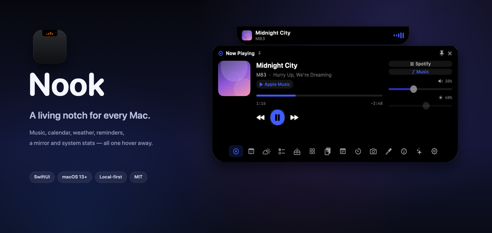

## The collapsed notch

  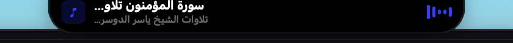

A real capture of the strip at the top of a desktop while audio plays. The strip
uses the same square top edge as the hardware notch, draws artwork, title, artist
and a live waveform, and keeps the camera housing clear.

 

  

A render of the same strip with rounded artwork on a clean background, used as a
reference for the notch silhouette.

## Now Playing

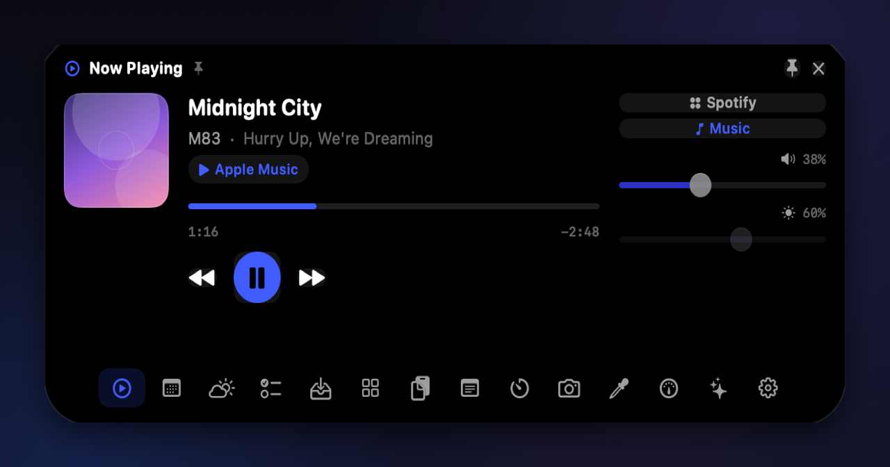

Artwork, title and album, transport controls, a draggable seek bar and volume,
plus one-click switching between output players. The collapsed strip comes from
this same service.

## Calendar

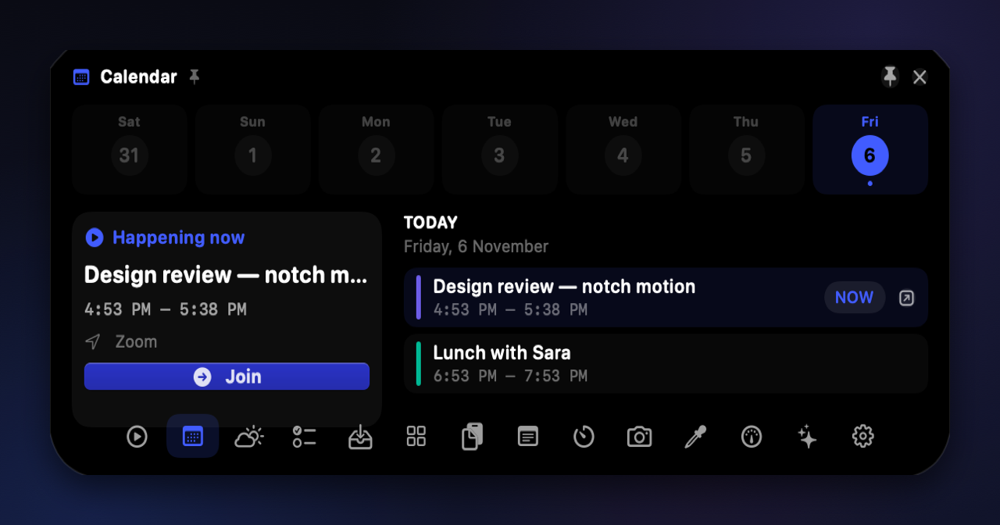

A week strip, the next event with a **Join** button, and the rest of today. The
next meeting also appears as a collapsed notch pill with a minute countdown.

## Weather

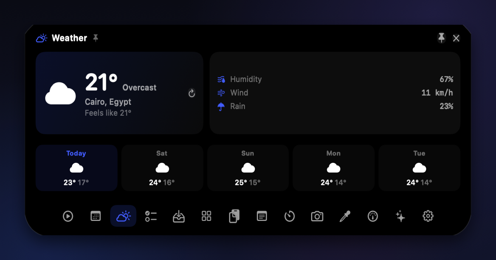

Current conditions, feels-like, humidity, wind, rain chance and a five-day
outlook for any city, powered by Open-Meteo.

## Reminders

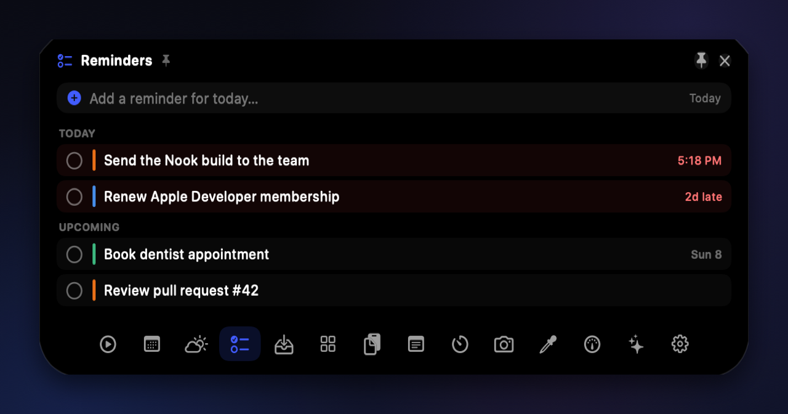

Your lists with completion state, edited in place without opening the app.

## Timer

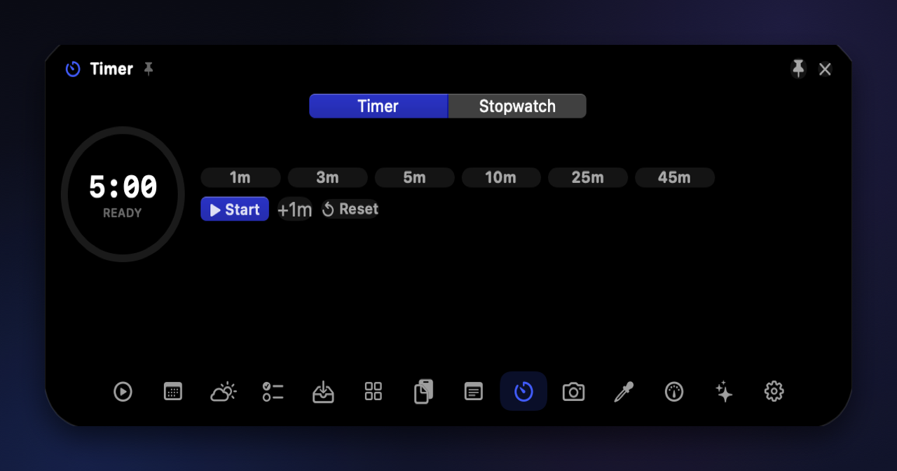

Presets, a breathing progress ring and a live countdown in the collapsed notch.

## Mirror

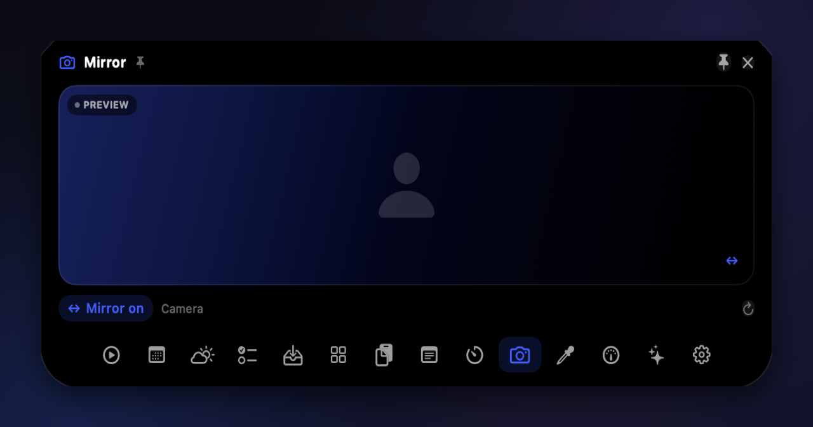

A quick camera preview for the moment before a call. The feed never leaves the
Mac.

## Notes

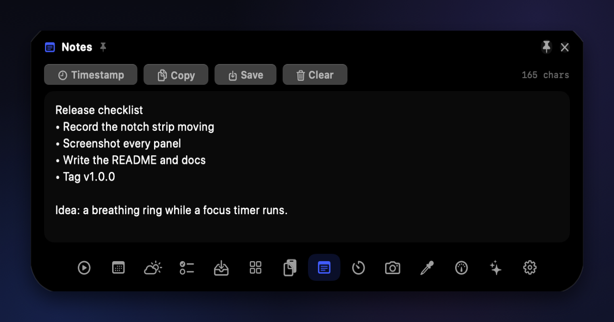

A single scratchpad with a character count, saved to Application Support so it
survives restarts.

## Agents

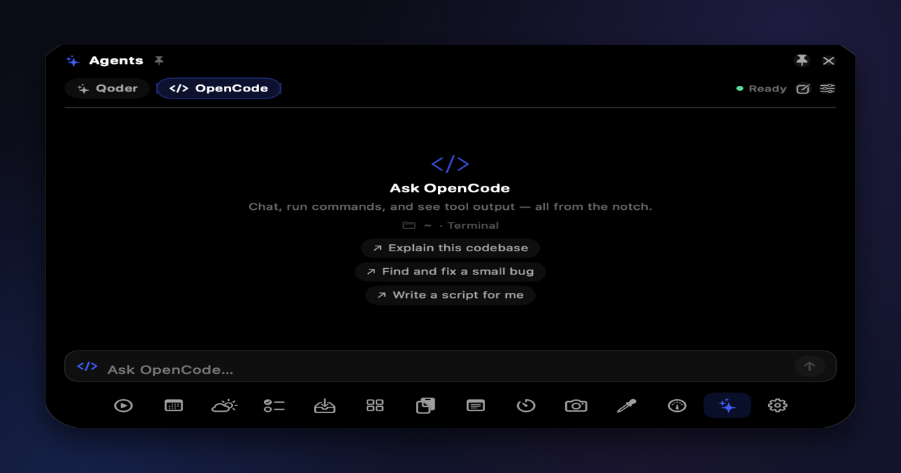

Chat with **Qoder CLI** or **OpenCode** from the notch. Tool calls, command output
and streaming responses render inline, and the collapsed pill shows what the
agent is doing while you work elsewhere.

## System

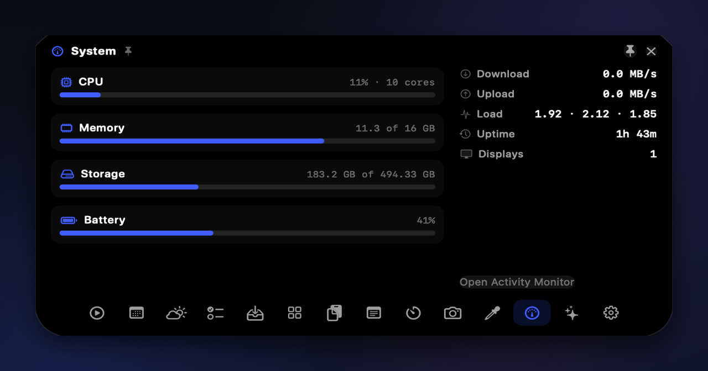

CPU, memory, disk and battery gauges with network throughput, load average,
uptime and display count.

## Shelf

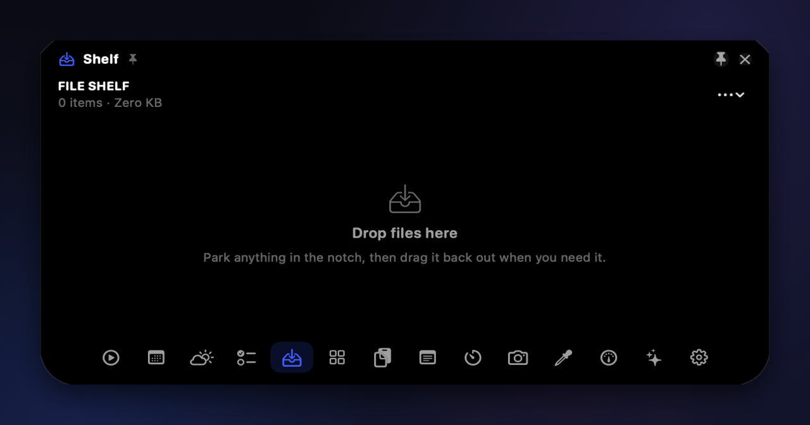

Drop files, images or archives on the notch to park them; drag them back out when
you need them. Archives can be unpacked in place.

## Settings

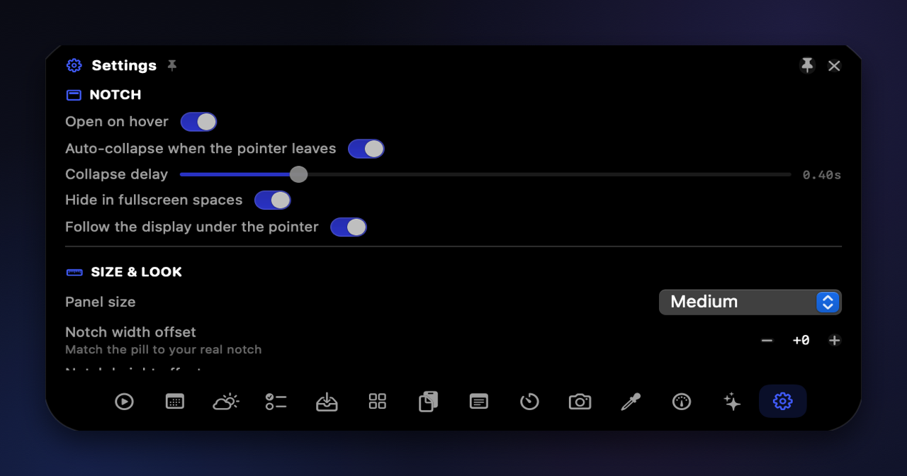

Gestures, auto-collapse behaviour, panel size, notch offsets, accent, opacity,
visible tabs, tools, weather city, agent defaults, launch at login and a Quit
button.

---

**Clipboard, Shortcuts and Colour** are shipped but not pictured here: their real
screens contain personal clipboard text, app names and a desktop screenshot. The
demo renderer covers media, calendar and notes only.
